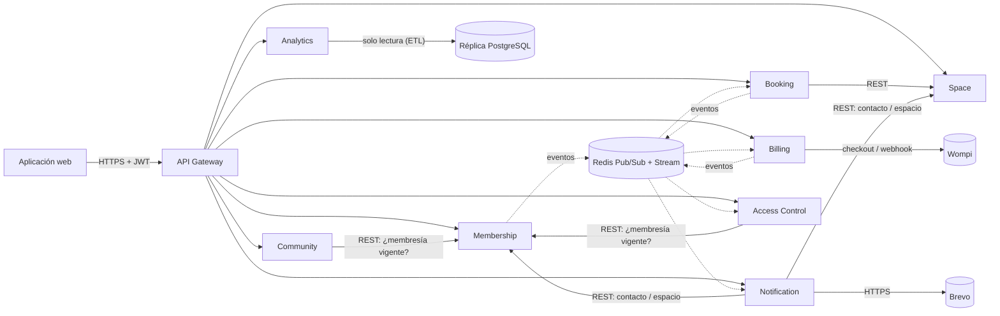

# CoworkSpace – Plataforma de gestión de espacios de coworking

Red de espacios de coworking construida con **8 microservicios**, un API Gateway y una aplicación web. Cada microservicio tiene su propio README, su `.env.example` y sus scripts de base de datos en `services/<servicio>/`.

| Servicio | Puerto | Responsabilidad | Schema BD | Despliegue |
|---|---|---|---|---|
| [api-gateway](services/api-gateway) | 3000 | Enrutamiento, JWT, rate limiting | – | https://coworkspace-gateway.onrender.com/health/services |
| [membership-service](services/membership-service) | 3001 | Miembros, login/refresh, planes, suscripciones y renovación | `membership` | https://coworkspace-membership.onrender.com/health |
| [space-service](services/space-service) | 3002 | Sedes, salas, puestos, fotos y mapa (caché Redis) | `space` | https://coworkspace-space.onrender.com/health |
| [booking-service](services/booking-service) | 3003 | Reservas con **bloqueo optimista**, lista de espera, saga | `booking` | https://coworkspace-booking.onrender.com/health |
| [billing-service](services/billing-service) | 3004 | Cobro recurrente, factura electrónica, cargos adicionales, **pasarela Wompi** | `billing` | https://coworkspace-billing.onrender.com/health |
| [notification-service](services/notification-service) | 3005 | Correos por eventos, recordatorios y avisos de vencimiento (Brevo) | `notification` | https://coworkspace-notification.onrender.com/health |
| [access-control-service](services/access-control-service) | 3006 | Credenciales QR/NFC de corta duración y validación en la puerta | `access` | https://coworkspace-access.onrender.com/health |
| [community-service](services/community-service) | 3007 | Directorio de miembros, mensajería y eventos de networking | `community` | https://coworkspace-community.onrender.com/health |
| [analytics-service](services/analytics-service) | 3008 | ETL de solo lectura y KPIs de ocupación, ingresos y retención | `analytics` | https://coworkspace-analytics.onrender.com/health |
| [frontend](frontend) | 5173 | Aplicación web (React) | – | https://coworkspace-web.onrender.com |

**Stack:** NestJS · React · Prisma · PostgreSQL · Redis (Pub/Sub, Streams y caché) · Google Maps · Wompi (sandbox) · Brevo · Docker · GitHub Actions · GHCR · Render · k6 · Prometheus/Grafana.

**Integraciones externas:** pasarela de pagos **Wompi** (sandbox), correo transaccional **Brevo** (API HTTP), mapas de **Google Maps** (embed) y geocodificación con **Nominatim/OpenStreetMap**, geolocalización del navegador para mostrar las sedes del país del usuario, y lectura de QR con la cámara (`BarcodeDetector`).

## Arquitectura



### Comunicación entre servicios

**Síncrona (REST, con `x-internal-key`):** Booking → Space (recurso a reservar) · Access Control y Community → Membership (`GET /subscriptions/member/:id/active`) · Notification → Membership y Space (datos del correo).

**Asíncrona (Redis Pub/Sub + copia en el Redis Stream `coworkspace:events`):**

| Evento | Publica | Consume |
|---|---|---|
| `membership.activated` | Membership | Billing (factura del periodo), Access Control (habilita el acceso), Notification (bienvenida y aviso de vencimiento programado) |
| `membership.expired` | Membership | Billing, **Access Control (revoca las credenciales)**, Notification |
| `booking.created` | Booking | Billing (paso 2 de la saga) |
| `billing.charge.approved` / `rejected` | Billing | Booking (confirma o **compensa**) |
| `billing.charge.pending` | Billing | (el miembro paga en Wompi) |
| `booking.confirmed` / `cancelled` | Booking | Billing (anula el cargo), Notification (correo + recordatorio) |
| `booking.waitlist.promoted` | Booking | Notification |

Los consumidores que usan el Stream (Notification, Access Control) leen con grupo de consumidores (`XREADGROUP` + `XACK`): si estaban dormidos en Render, procesan lo pendiente al despertar.

### Access Control (acceso físico)
- El miembro abre **Mi acceso** y ve un QR con un token `cw1.<credencial>.<secreto>` que vive 2 minutos y se renueva solo; el anterior deja de servir. La base solo guarda el hash SHA-256.
- Recepción (**Panel → Control de acceso**) escanea el QR con la cámara o pega el código. La validación busca por llave primaria, compara el hash en tiempo constante y consulta la proyección local de la membresía: responde en pocos milisegundos y queda en la bitácora `access_log`.
- Al recibir `membership.expired` revoca todas las credenciales del miembro.

### Analytics (KPIs)
ETL cada 30 minutos (y bajo demanda) que lee las bases de Membership, Space, Booking y Billing con una conexión de **solo lectura** (`default_transaction_read_only=on`; en producción, `SOURCE_DATABASE_URL` apunta a la réplica de lectura) y guarda en su schema: `occupancy_by_location` (sede × día × franja horaria), `revenue_by_plan` (plan × mes) y `member_retention` (cohortes).

### Patrón Saga coreografiada – "reserva de sala con cargo adicional"
1. Booking crea la reserva en `PENDING` y publica `booking.created`.
2. Billing revisa el plan del miembro: si el recurso está incluido → `approved` con monto 0; si no, el cargo es `horas × tarifa`.
   - **Con Wompi configurado:** el cargo queda `PENDING` y el miembro paga en el checkout de Wompi (sandbox). Billing confirma el resultado consultando la transacción al volver (`/pago?id=…`) y por el webhook firmado; publica `approved` o `rejected`.
   - **Sin llaves de Wompi:** pasarela simulada con cupo de `EXTRA_CHARGE_APPROVAL_LIMIT`.
3. Si el cobro se aprueba → Booking pasa la reserva a `CONFIRMED`.
4. Si se rechaza → Booking la pasa a `CANCELLED (PAYMENT_REJECTED)` y la lista de espera se promueve automáticamente.
5. Si el cobro no se completa, un cron cancela las reservas `PENDING` tras `SAGA_TIMEOUT_MINUTES` (20 en Render, para dar tiempo de pagar).

### Pago de membresías (Wompi)
Con las llaves de Wompi configuradas, "Pagar" en *Membresía* crea un pago pendiente en Billing y abre el checkout de Wompi (sandbox; tarjeta de prueba `4242 4242 4242 4242`). Al volver (`/pago?id=…`) o por el webhook firmado, Billing confirma la transacción y le pide a Membership activar el plan (`POST /subscriptions/internal/activate`, solo interno). Membership publica `membership.activated` y Billing emite la factura electrónica. Mientras la pasarela está activa, Membership rechaza la suscripción directa (402) para que nadie se salte el pago. Sin llaves, todo funciona con cobro simulado.

### Bloqueo optimista (sin dobles reservas)
Cada recurso tiene una fila `resource_locks(resource_id, version)`. Al reservar se lee la versión, se verifica que no haya solapamiento y, dentro de una transacción, se ejecuta `UPDATE ... SET version = version + 1 WHERE version = <leída>`. Si otra reserva concurrente ganó, el `UPDATE` afecta 0 filas, se reintenta y el reintento detecta el solapamiento (409). La prueba k6 lanza 50 reservas simultáneas sobre la misma sala y exige que exactamente una gane.

### Seguridad
- JWT de acceso de corta duración (15 min) + refresh tokens rotativos (se guardan hasheados).
- El Gateway borra cualquier header `x-user-*` que venga del cliente, valida el JWT y reenvía la identidad.
- Todos los servicios exigen el header `x-internal-key` (secreto compartido): aunque tengan URL pública en Render, no se pueden llamar saltándose el Gateway.
- Rate limiting: 120 req/min por IP (10/min en login).

## Correr en local

Requisitos: Docker Desktop.

```bash
docker compose up --build
# Con Prometheus (9090) y Grafana (3100, admin/admin):
docker compose --profile observability up --build
```

Gateway en `http://localhost:3000`. Estado de todos los servicios: `GET /health/services`.
Se crea automáticamente el admin `admin@coworkspace.co` / `Admin12345!` y los 4 planes del PDF.

### Pruebas
```bash
cd services/<servicio>
npm ci && npx prisma generate
npm run lint && npm test
```
El pipeline de GitHub Actions corre lint, Jest y build de los 9 servicios en paralelo, la prueba de carga k6 del Booking Service con todo el sistema levantado, y luego publica y despliega las imágenes.

### Base de datos: scripts, datos de ejemplo y respaldo
Cada servicio tiene en `db/`: `01_schema.sql` (esquema generado desde Prisma), `02_seed.sql` (datos de ejemplo idempotentes) y `03_backup.sql` (respaldo `pg_dump`). El workflow **Scripts de base de datos** (`scripts/db-scripts.sh`) los regenera, carga todo en un PostgreSQL limpio, corre el ETL de Analytics sobre esos datos y guarda los archivos.

Cargar todo a mano en una base vacía:
```bash
for s in membership space booking billing notification access-control community analytics; do
  psql "$DATABASE_URL" -f services/$s-service/db/01_schema.sql -f services/$s-service/db/02_seed.sql
done
```
Usuarios de ejemplo (contraseña `Demo12345!`): `admin.demo@coworkspace.co` (administrador), `coordinador@coworkspace.co`, `ana@demo.co`, `carlos@demo.co` (miembros con plan) y `mariana@demo.co` (plan vencido).

Carga con k6 (con el stack arriba): `k6 run load-tests/booking-peak.js`

## Recorrido de demostración (curl)

```bash
API=http://localhost:3000/api

# 1. Login admin y crear sede + sala
ADMIN=$(curl -s -X POST $API/auth/login -H 'Content-Type: application/json' \
  -d '{"email":"admin@coworkspace.co","password":"Admin12345!"}' | jq -r .accessToken)
LOC=$(curl -s -X POST $API/locations -H "Authorization: Bearer $ADMIN" -H 'Content-Type: application/json' \
  -d '{"name":"Sede Centro","city":"Montería","address":"Cra 1 # 2-3"}' | jq -r .id)
ROOM=$(curl -s -X POST $API/rooms -H "Authorization: Bearer $ADMIN" -H 'Content-Type: application/json' \
  -d "{\"locationId\":\"$LOC\",\"name\":\"Sala Sinú\",\"capacity\":8,\"equipment\":{\"projector\":true}}" | jq -r .id)

# 2. Registrar miembro y suscribirlo al plan "Puesto flexible" (NO incluye salas)
TOKEN=$(curl -s -X POST $API/auth/register -H 'Content-Type: application/json' \
  -d '{"name":"Ana","email":"ana@test.co","password":"Password123!"}' | jq -r .accessToken)
PLAN=$(curl -s $API/plans | jq -r '.[] | select(.code=="FLEX_DESK") | .id')
curl -s -X POST $API/subscriptions -H "Authorization: Bearer $TOKEN" -H 'Content-Type: application/json' -d "{\"planId\":\"$PLAN\"}"

# 3. Reserva de 2 h fuera del plan -> cargo de 100.000 aprobado -> CONFIRMED
curl -s -X POST $API/bookings -H "Authorization: Bearer $TOKEN" -H 'Content-Type: application/json' \
  -d "{\"resourceType\":\"ROOM\",\"resourceId\":\"$ROOM\",\"startTime\":\"2026-12-01T14:00:00Z\",\"endTime\":\"2026-12-01T16:00:00Z\"}"

# 4. Reserva de 5 h -> 250.000 supera el cupo simulado -> compensación: CANCELLED (PAYMENT_REJECTED)
curl -s -X POST $API/bookings -H "Authorization: Bearer $TOKEN" -H 'Content-Type: application/json' \
  -d "{\"resourceType\":\"ROOM\",\"resourceId\":\"$ROOM\",\"startTime\":\"2026-12-02T13:00:00Z\",\"endTime\":\"2026-12-02T18:00:00Z\"}"

sleep 1
curl -s $API/bookings/me -H "Authorization: Bearer $TOKEN" | jq '.[] | {status, cancelReason}'
curl -s $API/charges/me -H "Authorization: Bearer $TOKEN"
curl -s $API/invoices/me -H "Authorization: Bearer $TOKEN"
```

## Roles y vistas

| Rol | Vista en la web | Qué puede hacer |
|---|---|---|
| **Administrador** (jefe) | Panel de administración | Todo: resumen, usuarios y roles, planes y precios, facturación, correos, ingresos en Analítica, más todo lo del coordinador y del miembro |
| **Coordinador** | Panel de coordinación | Sedes y servicios, salas y puestos, ocupación, control de acceso en la puerta, eventos de networking y analítica de ocupación/retención. No gestiona usuarios, planes ni facturación |
| **Miembro** | Mi cuenta | Buscar sedes de su país, reservar y pagar con Wompi, Mi acceso (QR), Comunidad (directorio, eventos, mensajes), membresía, pagos, notificaciones y perfil |

El primer administrador se crea con `ADMIN_EMAIL` / `ADMIN_PASSWORD`. Después, el administrador asigna roles desde **Usuarios y roles** (no puede cambiar su propio rol y siempre queda al menos un administrador). Los permisos se validan en cada microservicio, no solo en la interfaz.

## Endpoints

La lista completa (método, ruta, quién puede usarla) está en el README de cada microservicio. Todos se consumen por el Gateway con el prefijo `/api`; cada servicio expone además `GET /health` y `GET /metrics` (Prometheus).

## Despliegue (GitHub Actions → GHCR → Render)

1. **Sube el repo a GitHub** (rama `main`). El workflow `.github/workflows/ci-cd.yml` corre lint, tests, la prueba k6 y publica las 9 imágenes en `ghcr.io/<tu-usuario>/coworkspace-<servicio>`.
2. **Haz públicas las imágenes:** en GitHub → tu perfil → *Packages* → cada paquete → *Package settings* → *Change visibility* → Public. (O configura una credencial de registro en Render.)
3. **Crea la infraestructura en Render:** en Render: *New → Blueprint* → selecciona el repo. Esto crea la BD PostgreSQL, Redis (Key Value), los 9 servicios, el sitio web y los secretos compartidos.
4. **Completa las variables marcadas `sync: false`** que Render te pedirá:
   - `ADMIN_EMAIL`, `ADMIN_PASSWORD` (membership).
   - Opcionales: `BREVO_API_KEY`, `MAIL_FROM` (notification) y `WOMPI_PUBLIC_KEY`, `WOMPI_INTEGRITY_SECRET`, `WOMPI_EVENTS_SECRET` (billing; llaves de prueba de comercios.wompi.co → *Desarrolladores*). En Wompi, configura la URL de eventos `https://coworkspace-web.onrender.com/api/payments/wompi/webhook`.
5. **Deploy automático:** en cada servicio de Render → *Settings* → *Deploy Hook*, copia la URL y guárdala en GitHub → *Settings → Secrets and variables → Actions* como `RENDER_DEPLOY_HOOK_MEMBERSHIP`, `_SPACE`, `_BOOKING`, `_BILLING`, `_NOTIFICATION`, `_ACCESS`, `_COMMUNITY`, `_ANALYTICS` y `_GATEWAY`. Desde ese momento cada push a `main` despliega la imagen del commit.
6. Verifica: `https://coworkspace-gateway.onrender.com/health/services`.

### Notas sobre el plan gratuito de Render
- Los servicios free se **duermen** tras un rato sin tráfico y tardan cerca de un minuto en despertar. Antes de la demo abre `/health/services` para despertarlos todos.
- Mientras un servicio duerme no recibe eventos de Redis Pub/Sub. Por eso Notification y Access Control leen el Redis Stream (procesan lo pendiente al despertar) y la saga tiene timeout.
- Las redes privadas completas (servicios `pserv`) requieren plan pago; por eso los servicios se comunican por URL pública protegida con `INTERNAL_API_KEY`.
- La BD usa un schema por servicio dentro de una sola instancia PostgreSQL (el plan free permite una sola BD). Cada servicio solo accede a su schema.

## Variables de entorno principales

| Variable | Servicio | Por defecto |
|---|---|---|
| `JWT_SECRET`, `INTERNAL_API_KEY` | todos | — |
| `ACCESS_TOKEN_TTL`, `REFRESH_TOKEN_TTL_DAYS` | membership | `15m`, `7` |
| `BILLING_CYCLE_DAYS` | membership | `30` |
| `CACHE_TTL_SECONDS` | space | `60` |
| `OPTIMISTIC_LOCK_MAX_RETRIES`, `MAX_BOOKING_HOURS`, `SAGA_TIMEOUT_MINUTES` | booking | `5`, `12`, `5` |
| `EXTRA_ROOM_HOURLY_RATE`, `EXTRA_DESK_HOURLY_RATE` | billing | `50000`, `15000` |
| `EXTRA_CHARGE_APPROVAL_LIMIT`, `PAYMENT_FORCE_REJECT` | billing | `200000`, `false` |
| `WOMPI_PUBLIC_KEY`, `WOMPI_INTEGRITY_SECRET`, `WOMPI_EVENTS_SECRET` | billing | vacías (pasarela simulada) |
| `BREVO_API_KEY`, `MAIL_FROM`, `REMINDER_MINUTES_BEFORE`, `MEMBERSHIP_WARNING_DAYS` | notification | vacías (modo demostración), `60`, `3` |
| `ACCESS_QR_TTL_SECONDS`, `ACCESS_NFC_TTL_DAYS` | access-control | `120`, `30` |
| `MEMBERSHIP_CACHE_SECONDS` | community | `60` |
| `SOURCE_DATABASE_URL`, `ANALYTICS_ETL_CRON`, `ANALYTICS_TZ` | analytics | `DATABASE_URL`, cada 30 min, `America/Bogota` |
| `RATE_LIMIT_PER_MINUTE`, `LOGIN_RATE_LIMIT_PER_MINUTE`, `CORS_ORIGIN` | gateway | `120`, `10`, `*` |

Desplegado en Render: https://coworkspace-gateway.onrender.com
